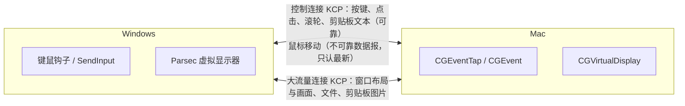

# SeeBarSideCar

一套鼠标键盘同时控制一台 Windows 电脑和一台 Apple Silicon Mac。两台机器在同一个局域网里直连，不经过任何云服务，也不依赖第三方 KVM 软件。程序名是 `magic`。

## 功能

- **跨屏键鼠**：鼠标移过配置好的屏幕边缘，就进入另一台电脑继续操作，键盘输入也随之切换。
- **剪贴板同步**：文本、图片（截图、浏览器里的「复制图片」、聊天软件里复制的图片）自动同步；在资源管理器 / 访达里复制的文件和文件夹，也能在另一台机器上直接粘贴。
- **Cmd / Ctrl 互换**：在 Mac 键盘上按 Cmd+C，Windows 收到的是 Ctrl+C；反过来也一样（可关闭）。
- **跨屏窗口（扩展桌面）**：把本机任意应用窗口拖过共享边缘，它就出现在对方屏幕上，在那边可以直接点击、滚动、打字；拖回来就回到本机。
- **紧急释放**：按 ScrollLock 或 Ctrl+Alt+Shift+Esc，立即把键鼠还给本机。
- **本机状态页**：`http://127.0.0.1:24801` 显示连接状态、延迟、虚拟显示器和跨屏窗口。

## 工作原理



- 两台机器运行同一个程序，各自一份 JSON 配置；鼠标先撞到共享边缘的一方就是控制端。
- 每条链路有两个 KCP（基于 UDP 的可靠传输）会话：
  - **控制连接**：低延迟设置。按键、点击和滚轮走可靠有序通道。
  - **大流量连接**：开启拥塞控制，传窗口画面、文件和大图片，不会挡住键鼠。
- **鼠标移动**走控制连接上的不可靠数据报。中间位置不需要精确，只要最新的，所以丢了就不重传：后到的新位置不必等旧位置重传，Wi‑Fi 丢包时不会卡顿。
  - 每个数据报带绝对坐标，13 字节定长，另外单独加密并带递增计数器，防止重放。
  - 按键和点击会附带当前坐标，以及最后一个移动数据报的编号。这样迟到的旧移动不会在点击之后把指针拽回去。
  - 鼠标停下约 16 ms 后，最终位置会经可靠通道再发一次，保证指针最终停在正确位置。
- 握手用共享密钥认证双方，再经 HKDF 派生出每个方向各自的 ChaCha20-Poly1305 密钥，所有流量都加密并防篡改。
- 连接后每台机器各多出一块虚拟显示器，代表对方紧贴共享边缘的那块屏幕。拖到这块显示器上的窗口按 64×64 分块对比，只把有变化的块以 JPEG 发给对方显示。
- KCP 用的是 [kcp-go](https://github.com/xtaci/kcp-go) v5.7.5 的修改版，放在 `third_party/kcp-go`，改动见 [`FORK.md`](third_party/kcp-go/FORK.md)：
  - 不开 FEC 也能发不可靠数据报；
  - 按会话设置最小重传超时（控制连接为 15 ms）；
  - 只重复发送含数据的包，纯 ACK 不重复。

## 系统要求

- Windows 10 / 11 x64。
- macOS 14 或更新，Apple Silicon（暂不提供 Intel Mac 版本）。
- 两台机器在同一局域网，能互相访问 UDP 24800 端口。有线网络最好；都用 Wi‑Fi 时偶尔会有几十毫秒的延迟尖峰。
- 跨屏窗口：Windows 需要安装 Parsec 虚拟显示器驱动（见下文），macOS 不需要额外安装。
- 两台机器必须运行同一协议版本（当前为 4）。版本不一致时，日志会提示「peer runs an incompatible version; update both machines」，并且不会建立连接。

## 编译

需要 Go 1.26（在 Linux/macOS/Windows 任一平台交叉编译，不需要 C 编译器）：

```bash
./build.sh
```

产物在 `dist/`：

| 文件 | 用途 |
| --- | --- |
| `magic-windows-amd64.exe` | Windows 程序 |
| `magic-darwin-arm64` | macOS 裸可执行文件 |
| `Magic.app` | macOS 应用包（推荐使用，便于授予权限） |

## 配置

每台机器一份配置，两份的 `secret` 必须相同，`edge` 互为相反方向，`peer` 填对方的局域网 IP 和端口。

示例：Windows 放在 Mac 的右边，Mac 的 IP 是 `192.168.1.10`，Windows 的 IP 是 `192.168.1.20`。

Mac 上的 `~/magic.json`：

```json
{
  "name": "mac",
  "peer": "192.168.1.20:24800",
  "secret": "一段至少12个字符的长随机密码",
  "edge": "right"
}
```

Windows 上的 `config.json`：

```json
{
  "name": "pc",
  "peer": "192.168.1.10:24800",
  "secret": "一段至少12个字符的长随机密码",
  "edge": "left"
}
```

完整示例见 [`config.example.json`](config.example.json)。

| 字段 | 默认值 | 说明 |
| --- | --- | --- |
| `name` | 主机名 | 本机显示名称（出现在对方的日志和状态页里） |
| `listen` | `":24800"` | 本机监听地址（UDP） |
| `peer` | 必填 | 对方地址，如 `192.168.1.20:24800` |
| `secret` | 必填 | 共享密钥，至少 12 个字符，两边必须一致 |
| `edge` | 必填 | 对方在本机屏幕的哪一侧：`left` / `right` / `top` / `bottom` |
| `swap_cmd_ctrl` | `true` | 两边系统不同时互换 Cmd 与 Ctrl |
| `clipboard` | `true` | 同步剪贴板（文本、图片和文件） |
| `virtual_display` | `true` | 连接后创建虚拟显示器，使窗口可以拖到对方屏幕；设为 `false` 只共享键鼠和剪贴板 |
| `switch_delay_ms` | `120` | 鼠标在共享边缘停留多久（毫秒）才切到对方，防止误触；负数表示立即切换 |
| `panel` | `"127.0.0.1:24801"` | 状态页地址，只能是回环地址 |
| `fps` | `15` | 跨屏窗口画面的最高帧率 |
| `jpeg_quality` | `70` | 跨屏窗口画面 JPEG 质量（1–100） |
| `mouse_scale` | `1.0` | 控制对方时鼠标移动速度倍数。两边屏幕缩放（HiDPI/Retina）差异较大时调整，例如 Mac 控制 4K 缩放 150% 的 Windows 感觉太慢可调到 1.5 |
| `file_clip_max_mb` | `2048` | 一次复制的文件总大小上限（MB），超过则不传输；设为 `-1` 关闭文件复制 |

## Windows 虚拟显示器驱动

跨屏窗口需要在 Windows 上安装 Parsec 虚拟显示器驱动（只需安装一次，magic 会在连接时自动添加、断开时自动移除虚拟显示器，不需要安装或登录 Parsec 本体）。以管理员身份打开终端执行：

```bat
winget install -e --id Parsec.ParsecVDD
```

macOS 不需要额外安装。没有安装驱动或创建失败时，键鼠和剪贴板照常工作，只是窗口不能拖到对方屏幕（日志和状态页会提示）。

## macOS 首次运行

1. 把 `dist/Magic.app` 复制到 Mac（例如 `/Applications`）。
2. 进行本地临时签名（否则权限无法保存）：

   ```bash
   codesign --force --deep -s - /Applications/Magic.app
   ```

3. 在「系统设置 → 隐私与安全性」中授予以下权限：
   - **辅助功能**（模拟键鼠输入）
   - **输入监控**（捕获键鼠）
   - **屏幕录制**（跨屏窗口画面）
4. 启动，两种方式任选：
   - 在「终端」中运行（权限需要授予「终端」）：

     ```bash
     /Applications/Magic.app/Contents/MacOS/magic -config ~/magic.json
     ```

   - 作为应用启动（权限授予 Magic）：

     ```bash
     open /Applications/Magic.app --args -config ~/magic.json
     ```

   授权后需要重新启动程序才生效。重新编译或重新签名后，macOS 可能要求重新授权（在列表里删除旧条目再添加）。

## Windows 运行

```bat
magic-windows-amd64.exe -config config.json
```

首次运行请放行防火墙（以管理员身份在命令提示符执行，只对「专用」网络开放）：

```bat
netsh advfirewall firewall add rule name="magic" dir=in action=allow protocol=UDP localport=24800 profile=private
```

并确保当前网络在 Windows 中设置为「专用网络」。若需要控制以管理员身份运行的窗口（任务管理器、安装程序等），请以管理员身份运行 magic。

## 使用

- 把鼠标推到配置的屏幕边缘并稍作停留（`switch_delay_ms`，默认 120 毫秒）即切换到另一台电脑，整条边缘都可以切换，上下位置按比例对应；从对方的对应边缘推回即可返回。返回后需要先把鼠标从边缘移开一点，才会再次触发切换。
- **紧急释放**：按 **ScrollLock** 或 **Ctrl+Alt+Shift+Esc**，立即把键鼠控制权还给本机。
- **状态页**：浏览器打开 <http://127.0.0.1:24801>（每 2 秒自动刷新），可以看到连接状态、本机虚拟显示器的位置和是否创建成功、本机拖到对方屏幕上的窗口，以及对方显示在本机的窗口。状态页只读，没有任何操作按钮。

### 跨屏窗口（扩展桌面）

连接后两台机器各自多出一块**虚拟显示器**，紧贴在共享边缘外侧，大小与对方贴着边缘的那块屏幕相同（自动换算两边的 HiDPI/Retina 缩放）。它在本机看不见，代表的就是对方的屏幕：放到这块显示器上的窗口，会以同样的位置和大小显示在对方屏幕上。

- **拖过去**：按住任意应用窗口的标题栏，像在多显示器之间一样直接拖过共享边缘。拖动过程中窗口跨在边缘时，两边各显示一半；松开鼠标后指针也随之进入对方电脑，可以继续操作。
- **在对方那边使用**：对方屏幕上的窗口可以直接点击、滚动、打字，操作会送回本机的真实窗口；画面实时更新。它也出现在对方的任务栏 / 程序坞 / Alt-Tab / Cmd-Tab 中，标题为「应用名 — 窗口标题」。
- **拖回来**：在对方屏幕上拖动它的标题栏，拖回共享边缘即可回到本机。也可以在本机用快捷键（Win+Shift+方向键、窗口菜单等）把它移回真实屏幕。
- **在对方关掉显示**：在对方的任务栏 / 程序坞里关闭它只会隐藏这份画面，不会关闭本机的应用；窗口离开虚拟显示器后再拖过去会重新显示。（Alt+F4 / Cmd+W 等快捷键会照常发给应用本身。）
- **断开 / 退出**：虚拟显示器随之移除，留在上面的窗口由系统自动挪回本机的真实屏幕。
- **显示设置里会看到什么**：连接期间，Windows 的「设置 → 系统 → 屏幕」和 macOS 的「系统设置 → 显示器」中会多出一块显示器，位置在共享边缘外侧；请不要手动调整它的位置或分辨率，magic 会在需要时自动重新设置。断开后它会消失。
- **前提**：Windows 需要安装 Parsec 虚拟显示器驱动（见上文「Windows 虚拟显示器驱动」），macOS 无需安装；`virtual_display` 为 `true`。虚拟显示器创建失败时，只有窗口不能拖过去，键鼠与剪贴板不受影响。
- 限制：
  - 对方屏幕上的多个跨屏窗口之间、以及它们与对方本地窗口之间的前后顺序不会同步；点击哪个窗口，哪个就到最前。
  - 画面是本机窗口的截图实时传输，有一两帧延迟；使用 DRM 或 GPU 直接渲染的内容（视频网站、部分游戏、硬件加速内容）可能显示为黑色。
  - 最小化的窗口无法捕获画面，会暂时从对方屏幕消失，还原后恢复。
  - 从本机开始的拖动过程中，对方屏幕上不显示鼠标指针，被拖动的窗口本身就是指示。
  - 不是所有应用都能完美呈现，例如带阴影、半透明或不规则形状的窗口边缘可能显示为不透明的色块。

### 剪贴板同步

- 在一台机器上复制文本或图片（例如截图、浏览器中的「复制图片」），即可在另一台机器上粘贴。图片以 PNG 格式传输，单张上限为 64 MB。
- 剪贴板里同时有多种内容时，按优先级只传一种：能读取的文件 > 图片 > 文本。
- 有些应用（例如 Mac 上的 Telegram）复制图片时，会附带一个其他程序没有权限读取的文件路径。这种文件会被跳过，改为传图片本身。
- 程序启动时剪贴板里已有的内容不会同步，只同步之后的新复制。

#### 文件复制

- 在一台机器的资源管理器 / 访达里选中文件或文件夹，按 Ctrl+C / Cmd+C 复制；到另一台机器上按 Ctrl+V / Cmd+V 粘贴即可。
- 复制后立即开始在后台传输（日志里每 10% 打印一次进度），传完后对方的剪贴板才变成这些文件；大文件请等传输完成再粘贴。
- 文件先存放在接收方的缓存目录里（只保留最近 3 次传输，更早的自动删除），粘贴时由资源管理器 / 访达从那里复制到目标位置：
  - Windows：`%LOCALAPPDATA%\magic-clip\`
  - macOS：`~/Library/Caches/magic-clip/`
- 一次复制的总大小上限默认 2048 MB（`file_clip_max_mb`），超过时不会传输（日志中有提示）。
- 传输过程中再复制别的内容，或连接断开，正在进行的传输会被放弃。
- 只传普通文件和文件夹（保留 Unix 权限位）；快捷方式 / 符号链接会被跳过。在 Windows 上，名字中含 `<>:"|?*` 等 Windows 不允许字符的文件会导致整次复制被拒收。
- 需要 `clipboard` 为 `true`。

## 安全

- 共享密钥至少 12 个字符，建议使用 20 位以上的随机字符串；两台机器配置相同密钥。
- 握手用共享密钥认证双方，会话密钥经 HKDF 派生，所有流量使用 ChaCha20-Poly1305 加密并防篡改。
- 仅限局域网直连使用：**绝对不要在路由器上做端口转发**把 24800 暴露到公网。
- 状态页只监听 127.0.0.1、只读，并校验 Host，防止其他网页借 DNS 重绑定读取。
- 只有跨到虚拟显示器上（哪怕只有一部分）的窗口会被对方看到和操作；状态页中「本机拖到对方屏幕上的窗口」一栏可随时核对。不想共享窗口时把 `virtual_display` 设为 `false`。

## 已知限制

- Windows 的 UAC 提示、锁屏/登录界面属于安全桌面，无法被控制或捕获。
- magic 未以管理员身份运行时，无法向管理员权限的窗口输入。
- 使用 DRM 或 GPU 直接渲染的窗口（视频网站、部分游戏、硬件加速内容）拖到对方屏幕上时可能显示为黑色。
- 最小化的窗口无法捕获画面；跨屏窗口最小化后会从对方屏幕消失，还原后恢复。
- 不支持跨机器拖放文件；文件需要用复制粘贴传输。
- 两边屏幕缩放差异较大时，鼠标速度可能不自然，请调整 `mouse_scale`。
- 尚未在真实硬件上完整测试，欢迎反馈问题。
- 鼠标移动丢包不重传，丢掉的中间点不会补发。在对方机器上用绘图软件画线时，丢点处会被连成直线（每 2–4 ms 一个点，通常察觉不到）。
- 只支持局域网直连，不做 NAT 穿透或中继。

## 排障

- **日志位置**：程序把日志写到标准错误输出，请在启动时重定向到文件，例如 Windows 用 `magic-windows-amd64.exe -config config.json >> magic.log 2>&1`，Mac 用 `... -config ~/magic.json >> ~/magic.log 2>&1`。每 30 秒会记录一行 `link:`，包含延迟和重传率；程序正常退出时会记录 `shutting down: <原因>`。
- **连不上**：检查两边 `secret` 是否一致、`peer` 地址是否正确、Windows 防火墙是否放行 UDP 24800，以及当前网络是否设为「专用网络」。日志出现 `incompatible version` 时，说明两边版本不同，请同时更新两台机器。
- **Mac 上鼠标能过去但键盘无效**：缺少「输入监控」或「辅助功能」权限。授权后需要重启程序。
- **窗口拖不过去**：日志或状态页提示虚拟显示器创建失败。Windows 上请确认已安装 Parsec 虚拟显示器驱动。Mac 屏幕休眠时也可能暂时无法创建，唤醒后会自动重试。
- **鼠标偶尔卡顿**：先看状态页的输入延迟。两台机器都用 Wi‑Fi 时，几十到一百多毫秒的尖峰通常来自无线网络本身。有一台插网线，或把 Windows 电源计划里「无线适配器设置」改成最高性能，效果最明显。

## 开发

```text
cmd/magic          入口：读取配置，启动平台层和应用层
internal/app       连接管理、键鼠切换、鼠标数据报、剪贴板/文件同步、跨屏窗口、状态页
internal/plat      操作系统接口：Windows（x/sys/windows）、macOS（purego + Objective-C 运行时，不用 cgo）
internal/proto     消息定义、加密握手、记录流与数据报加密
internal/keymap    USB HID 键码与 Windows 扫描码 / macOS 键码互转
third_party/kcp-go 修改版 kcp-go（独立 Go 模块，经 go.mod 的 replace 引用）
```

```bash
go test -race ./...                                   # 主模块测试
(cd third_party/kcp-go && go test -race ./...)        # KCP 修改版测试
for t in linux/amd64 windows/amd64 darwin/arm64; do   # 三个平台静态检查
  GOOS=${t%/*} GOARCH=${t#*/} CGO_ENABLED=0 go vet ./...
done
```

- 始终 `CGO_ENABLED=0`，在 Linux 上就能交叉编译两个平台。
- 只要线上格式有任何变化（新消息类型、字段含义、数据报布局），就必须把 `internal/proto` 里的 `Version` 加一。

## 许可

`third_party/kcp-go` 沿用上游的 MIT 许可证（见该目录下的 `LICENSE`）。
